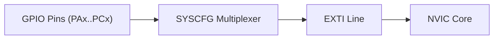

# MCU Course - STM32F401RE

## Debug and Trace - ARM Cortex-M (STM32)

### 1. Debug Interface: SWD
_SWD (Serial Wire Debug)_ is a 2-wire protocol for accessing the debug and memory ports of the Cortex-M core. It is the pin-reduced alternative to JTAG.

| Pin     | Direction |Role                       |
|---------|-----------|---------------------------|
| SWDIO   | I/O       | Bidirectional data        |
| SWCLK   | Out->MCU  | Clock                     |
| SWO     |MCU->Out   |Optional trace output      |

**What you can do over SWD:**
- Program internal/external flash
- Read/write memory, set breakpoints
- Run / halt / step the CPU
- read core registers

_Debug probe:_ The PC talks to the board through a debug probe (ST-Link V2/V3/ J-Link, ...). The probe implements the SWD protocol and connects to the 10-pin Cortex debug header.

### 2. Trace Output: SWO 
_SWO (Serial Wire Output):_ is an _optional, unidirectional_ pin that carries trace data _from_ the core _to_ the probe. It is *not* part of the SWD data path, it is a separate signal.

### 3. Trace Protocol: SWV
_SWV (Serial Wire Viewer)_ is the _protocol_ that structures the data on the SWO pin. It is decoded by the debugger/IDE.

SWV frames can carry:
- ITM stimulus ports 0-31 (software-generated data)
    - Port 0 -> print-style text
    - Port 31 -> RTOS event viewer
- DWT events (cycle count, PC samples, data access, exceptions)

so SWV != "printf only". Printf() is just the most common use.

### 4. Hardware Unit: ITM
_ITM (Instrumentation Trace Macrocell)_ is a peripheral _inside_ the Cortex-M core (Cortex-M3 or above). It has 32 stimulus ports (32-bit registers). Writing to a port queues a packet that is transmitted out on SWD.

Typical printf redirect:
1. Override `_write()` in the C runtime.
2. Call `ITM_SendChar(c)` for each character -> writes to ITM port 0.
3. The probe reads SWO, decodes SWV, and shows the text in the IDE console.

### TL;DR
- SWD: 2-wire bidirectional debug link (SWDIO + SWCLK)
- SWO: 1-wire unidirectional trace output pin (optional)
- SWV: the _protocol_ in the SWO pin (carries ITM-DWT data)
- ITM: the _hardware unit_ in the core that generates the data.

## Toggling Built-in LED Practice
Because I'm using the Nucleo-F401RE board, the way the course is turning on/off the built-in LED by toggling the SFRs is different. 

For the Nucleo-F401RE, the user LED (LD2, green) is on *PA5* not *PD12*, so follow these steps:
- Enable GPIOA clock (bit 0 of AHB1ENR). 
    - In IDE SFRs: RCC/AHB1ENR/GPIOAEN set bit to 1
- Set PA5 as output (MODER bits 11:10 = 0b10 -> set bit 10). 
    - In IDE SFRs: GPIOA/MODER/MODER5 set to bits to 0 1
- Toggle ODR5.
    - In IDE SFRs: GPIOA/ODR/ODR5 toggle

In code, this would look something like this:
```c
RCC->AHB1ENR |= (1 << 0);
GPIOA->MODER |= (1 << 10); // bits 11:10 = 01 -> output mode
GPIOA->ODR ^= (1 << 5);
```

## Memory Map of the MCU

### General
- 32-bit address but -> 2^32 addresses (`0x0000_0000` to `0xFFFF_FFFF`), i.e. 4GB addressable space.
- The memory map defined _boundary addresses_ of every on-chip memory and peripheral.
- The addressable space is divided into _8 blocks of 512MB_ each.


> **Key concept:** when the CPU places an address on the bus, the bus matrix routes it to the correct slave (flash, SRAM, or a peripheral register).
> Example: address `0x4002_0000` -> routed to GPIOA registers on the AHB1 bus.

### Base Addresses (STM32F401RE)

**Memories**
| Memory         | Base address | Size   | Bus / Notes                 |
|----------------|--------------|--------|-----------------------------|
| Flash          | 0x0800_0000  | 512 KB | Also aliased at 0x0000_0000 |
| SRAM           | 0x2000_0000  | 96 KB  |                             |
| System Memory  | 0x1FFF_0000  | 30 KB  | Bootloader / OTP            |

**Bus base address**
| Bus   | Base Address |
|-------|--------------|
| AHB1  | 0x4002_0000  |
| APB1  | 0x4000_0000  |
| APB2  | 0x4001_0000  |

**Peripherals**

- _AHB1 peripherals_ live in the `0x4002_xxxx` range.
- _APB1 peripherals_ live in the `0x4000_xxxx` range.
- _APB2 peripherals_ live in the `0x4001_xxxx` range.

> You must enable the clock for any peripheral (via RCC registers) before accessing it.

### Notes + Exercises 
- **Flash alias:** The STM32F4 memory map provides an alias/remap of Flash into the `0x0000_0000` region for boot/vector purposes, while Flash is normally located at `0x0800_0000`.
- **Endianness:** Little-endian. Lowest byte = LSB.
- The base address of the AHB1 Bus peripheral registers is `0x4002_0000`
- The base address of RCC engine registers of the MCU is `0x4002_3800`
- The base address of Flash Memory is `0x0800_0000` (found in Memory mapping figure in datasheet)
- The base address of ADC registers is `0x4001_2000` (specifically ADC1)

## Bus Interfaces

The processor and peripherals communicate via bus interfaces.

- I-BUS (I-Code): Instruction fetch from Flash
- D-BUS (D-Code): Data access to Flash 
- S-BUS (System): All other memory (SRAM) and peripheral access

**STM32F401RE Bus Matrix:**
- 32-bit multi-AHB bus matrix with round-robin arbitration
- Masters: CPU, DMA1, DMA2, USB OTG
- Slaves: FLash, SRAM, AHB1 peripherals, AHB2 peripherals, APB1, APB2

**Clock domains:**
- AHB1 / AHB2: up to 84 MHz
- APB2: up to 84 MHz
- APB1: up to 42 MHz (minimum prescaler is /2)

### Example in code:
```c
const char *pMessage = "Hello world";    // String literal in Flash - pointer in SRAM
const int value = 200;                   // Constant data - stored in Flash
char myData[50];                         // Non-constant data - stored in SRAM

int main(void)
{
    for (uint32_t i = 0; i < strlen(pMessage); i++){
        myData[i] = *(pMessage + i);     // Data copied from Flash to SRAM
    }
    for(;;);
}
```

After compiling, instructions and constant data are stored in Flash. The `myData` buffer (50 bytes) is part of the SRAM.

The Cortex-M4 reads instructions from Flash over _I-BUS_ and reads data stored in Flash over _D-BUS_.
- If instructions are outside `0x0000_0000` to `0x1FFF_FFFC`, the processor fetches them over _S-BUS_.
- If data is outside `0x0000_0000` to `0x1FFF_FFFF`, the processor fetches it over _S-BUS_.
- All peripherals are accessed over _S-BUS_ (their addresses are outside the code region). SRAM base address is `0x2000_0000`.


## Clocks

The main clock sources of the STM32F401RE areL

| Source | Type                              | Frequency             | Purpose                   |
|--------|-----------------------------------|-----------------------|---------------------------|
| HSE    | External (crystal or clock input) | 4-26 MHz              | High-speed system clock   |
| HSI    | Internal RC                       | 16 MHz (fixed)        | Default clock after reset |
| PLL    | Internal (multiplier)             | Up to 84 MHz (SYSCLK) | High-speed system clock   |

### HSE
External high-speed clock.  Can be a crystal connected to OSC_IN/OSC_OUT pins. Or a square-wave clock input from external source.
On the Nucleo-F401RE, no crystal is soldered on the MCU. The 8 MHz HSE comes from the ST-Link (STM32F103) via its MCO pin into the main MCU's OSC_IN.

### HSI 
Internal 16 MHz RC oscillator (factory-trimmed). This is the _default clock after reset_ the MCU runs from HSI until software switches to another source.

### PLL
Phase-Locked Loop. Takes either HSI or HSE as input and multiplies it. Has 2 outputs:
- _PLLCLK (VCO output / P)_: Used as SYSCLK (up to 84 MHz on F401RE)
- _PLL48CL_: Fixed 48 MHz output for USB OTG FS, SDIO and RNG

### SYSCLK (System Clock)
- HSI (16 MHz)
- HSE (4-26 MHz)
- PLLCLK ( up to 84 MHz)

After reset = SYSCLK - HSI. Software must explicitly switch to HSE or PLL for higher performance.

### Peripheral Clock Configuration
In modern MCUs, before using any peripheral, you must enable its peripheral clock using peripheral clock registers; by default, peripheral clocks of almost all peripherals will be disabled to save power.
> In STM32 microcontrollers, peripheral clocks are managed through RCC registers.


## Interrupts and NVIC

The _Vector Table_ is array of 32-bit addresses (pointers) stored at the beginning of memory (Flash starting at `0x0000_0000` / `0x0800_0000`). It tells the CPU where to jump when a system exception or hardware interrupt occurs.

- _Architecture:_ Core exceptions are defined by ARM; peripheral IRQs are defined by the MCU vendor (ST).
- _Location:_ Resides in Flash memory (ROM) and is populated by compiler-generated _startup code_ (`startup_stm32f401retx.s`).
- _First Entry:_ `0x0000_0000` is reserved for the initial _Main Stack Pointer (MSP)_ value.
- _Second Entry:_ `0x0000_0004` is the address of the `Reset_Handler` function.

> **Weak functions:** Startup code defines interrupts handlers using the `__attribute__((week))` attribute. This provides a default "do-nothing" loop that you can override anywhere in your main source code without compilation errors.

- _Position (IRQn):_ The fixed index/offset of an exception/interrupt in the vector table.
- _Priority Level:_ A numerical value that determines which interrupt takes precedence during simultaneous triggers or preemption.
- _Priority Type:_ Indicates whether an interrupt's priority level is static or configurable.

> **Priority fact:** Among configurable interrupts, core exceptions and critical hardware (like the window watchdog `WWDG` at IRQ0) are typically assigned the highest logical priority by software design.

>  Memory Sizing Example (STM32F407):  15 System Exceptions + 82 External IRQs + 1 MSP = 98 words then, the vector table size: 98 x 4 bytes = 392 bytes

### EXTI (External Interrupt Controller)

Peripheral interrupts route the core in 2 distinct ways:

1. _Direct Peripheral IRQs:_ Peripherals like TIM, USART, and I2C send interrupt signals directly to the NVIC.
2. _Indirect Peripheral IRQs:_ All GPIO pin interrupts route through the _EXTI engine_ (connected via the APB2 bus) before hitting the NVIC.



- 23 EXTI lines are connected to the NVIC
- 16 GPIO lines (EXTI0-EXTI15) map pin numbers 0 through 15 directly to EXTI line numbers.
- _SYSCFG routing_: Multiplexers select which GPIO controls a given EXTI line (configured using `SYSCFG->EXTI[x]`). **You cannot use `PA0` and `PB0` as EXTI inputs simultaneously.**

### Practical Hardware Example - Nucleo-F401RE User Button
On the Nucle-F401RE board, the onboard blue user button is hardwired to `PC13`:
1. Pin Map: `PC13` connect to **EXTI Line 13**
2. The `SYSCFG_EXTICR4` register routes Port C to EXTI13.
3. Pressing the button pulls the line LOW/HIGH, triggering the `EXTI15_10` shared interrupt line in the NVIC.

## GPIO (General Purpose Input Output)

### Overview
GPIO pins allow the microcontroller to interface with digital signals, trigger external hardware, fire interrupts, or wake up the CPU from low-power modes.
- _GPIO Port_: A grouping of up to 16 individuals I/O pins (named Pin 0 through Pin 15)
- _STM32F401RE Capacity_: All GPIO pins default to _Input Mode with High-Z (Floating state)_ to prevent unintended current flow.
- _Clock Dependency_: You must enable the peripheral clock via `RCC->AHB1ENR` (e.g. `RCC_AHB1ENR_GPIOAEN`) before accessing any GPIO ports registers.

### Input Configurations and States
Floating (High-Z) inputs are susceptible to electromagnetic noise, causing unpredictable software reads. Internal pull-up or pull-down resistors prevent floating states.

| State | Behavior | Default Logic Level |
| :--- | :--- | :--- | :--- |
| _Floating (High-Z) | Pin floats dynamically based on external noise. | Indeterminate (`0` or `1`) |
| _Pull-Up (UP)_ | Pulls pin to HIGH when left unconnected | HIGH (`1`) |
| _Pull-Down (PD)_ | Pulls pin to LOW when left unconnected | LOW (`0`) |

### Output Modes and Hardware Configurations

**Push-pull vs Open-Drain**
- _Pull-Pull_: Driven actively HIGH ($V_{DD}$) or LOW ($GND$) using two internal MOSFETs (P-MOS and N-MOS).
- _Open-Drain_: Only the bottom N-MOS transistors is active.
    - Driving `0` -> connects the pin to _GND_ (Active LOW)
    - Driving `1` -> Disables output transistor -> Pin foes _Floating (High-Z)_.
    - _Requirement_: Requires an internal or external pull-up resistor to pull the line HIGH to $V_{DD}$. Crucial for shared buses like _I2C_ or level shifting.

**Slew Rate (Output Speed)**
Configures how fast the pin transitions between logic leves (0 -> 1 and 1 -> 0).
- Options: Low, Medium, High and Very high.
- Rules of Thumb: Use higher speeds only for fast signals (e.g. SPI at 20MHz) to reduce EMI, ringing, and power consumption.

### GPIO Register Summary
Every GPIO port has a dedicated set of 32-bit special function registers (SFRs):

| Register | Name / Acronym | Purpose | Notes |
| :--- | :--- | :--- | :--- |
| **MODER** | Mode Register | Configures basic pin mode: `00` Input, `01` Output, `10` Alternate Function, `11` Analog. | 2 bits per pin |
| **OTYPER** | Output Type Register | Selects `0` Push-Pull or `1` Open-Drain. | 1 bit per pin (Only active in Output mode) |
| **OSPEEDR** | Output Speed Register | Configures output signal slew rate (Low, Medium, High, Very High). | 2 bits per pin (Only active in Output mode) |
| **PUPDR** | Pull-up / Pull-down Register | Selects `00` No PU/PD, `01` Pull-Up, `10` Pull-Down. | 2 bits per pin |
| **IDR** | Input Data Register | Reads the real-time digital state of the physical pin. | Read-only register |
| **ODR** | Output Data Register | Writes output logic state (`0` or `1`) to the pin. | Read / Write register |
| **AFRL** | Alternate Function Low | Selects AF selection (AF0 to AF15) for **Pins 0 to 7**. | 4 bits per pin |
| **AFRH** | Alternate Function High | Selects AF selection (AF0 to AF15) for **Pins 8 to 15**. | 4 bits per pin |

### Alternate Function (AF) Mapping
When a pin is in _Alternate Function mode (`MODER = 0b10`)_, the pin control is handed over to an internal peripheral:

- _Output side:_ Controlled directly by peripheral outputs (e.g. `USART_TX`, `SPI_SCK`, `I2C_SDA`, `TIM_CH1`).
- _Input side:_ Feeds directly into peripheral inputs (e.g., `USART_TX`, `ADC_IN`, `CAN_RX`).
- _Multiplexer:_ Each pin can route to 1 of 16 different peripheral signals (AF0 through AF15) via `AFRL` (pins 0-7) and `AFRH` (pins 8-15).

### Bare-Metal Driver Architecture

A standard module folder for custom peripheral drivers: 

```text
Drivers/
├── Inc/
│   ├── stm32f401xx.h      <-- Base addresses, MCU-specific structures & bitfield macros
│   ├── gpio_driver.h      <-- GPIO driver API prototypes, config structs, & macros
│   ├── spi_driver.h       <-- SPI driver API prototypes
│   ├── i2c_driver.h       <-- I2C driver API prototypes
│   └── uart_driver.h      <-- UART driver API prototypes
└── Src/
    ├── gpio_driver.c      <-- GPIO peripheral initialization & handle functions
    ├── spi_driver.c       <-- SPI driver implementation
    ├── i2c_driver.c       <-- I2C driver implementation
    └── uart_driver.c      <-- UART driver implementation
```


## SPI (Serial Peripheral Interface)

### Overview
SPI ias a synchronous, full-duplex, master-slave based interface used for short-distance board-level communication (e.g. sensors, displays, SD cards).

- _SCLK (Serial Clock)_: Generated solely by the master to synchronize data bit transfers.
- _MOSI (Master Out / Slave In)_: Transmits data from master to slave.
- _MISO (Master in / Slave Out_: Transmits data from slave to master.
- _NSS / SS (Slave Select)_: Active-low line used by the master to select a specific slave.

> **Slave High-Z Behavior**: A slave's MISO output remains in a high-impedance (Hi-Z) state until its SS line is drive _LOW_. This allow multiples slaves to share the same MISO line safely.

### Operating Principle: Shift Register
SPI transfer relies on circular shift registers shared between master and slave. 

- On every SCLk clock cycle, 1 bit shifted out and 1 bit is shifted in.
- _Fundamental Rule_: Transmitting and receiving occur simultaneously. When the master sends 1 byte, it automatically receives 1 byte in return.

### Bus Configuration and Topologies
| Mode | Lines Used | Hardware Connection | Description |
| :--- | :--- | :--- | :--- |
|Full-Duplex (Default) | MOSI, MISO, SCLK | Master MOSI -> Slave MOSI <br>Master MISO <- Slave MISO | Simultaneous bi-directional data transmission using two independent lines |
|Half Duplex | 1 Data Line, SCLK | Master MOSI -> Slave MISO (or MOSI) | Bi-directional communication over a single shared line, toggling direction between TX and RX. |
| Simplex (TX-Only / RX-Only) | MOSI (or MISO), SCLK | Master MOSI -> Slave MOSI | Unidirectional transmission. Unused datapns can be reclaimed for GPIO. ||

### Slave Select (NSS/SS) Management
In STM32, NSS pin behavior is controlled via the `SSM` (Software slave management) bit in `SPIx_CR1`.

#### Hardware Slave Management
- _Slave Mode_: The physical NSS pin acts as an input. The slave is enabled when NSS is pulled _LOW_ externally by the master.
- _Master Mode_: 
    - _NSS Output Disabled (`SSOE = 0`)_: NSS acts as an input. If pulled LOW by another master, a _Master Mode Fault (MODF)_ occurs to prevent multi-master bus collisions. 
    - _NSS Output Enabled (`SSOE = 1`)_: Hardware automatically pulls NSS LOW when SPI is enabled (SPE = 1) to drive a single slave.

#### Software Slave Management (`SSM = 1`)
- The physical NSS pin is detached from the SPI block and freed for standard GPIO use. 
- The internal NSS signal state is drive by software via the `SSI` (Internal Slave Select) bit in `SPIx_CR1`.
    - For Master mode: `SSI` must be set to `1` to avoid MODF errors.

### SPI Clock Formats (CPOL and CPHA)
Master and slave must agree on clock (`CPOL`) and phase (`CPHA`) to sample data correctly. Together, they define 4 SPI Modes (Modes 0-3).
- _CPOL (Clock Polarity)_: Controls the idle state of SCLK when no data is transferred.
    - `CPOL = 0`: SCLK idles **LOW**
    - `CPOL = 1`: SCLK idles **HIGH**
- _CPHA (Clock Phase)_: Controls which clock edge toggles vs captures the data bits.
    - `CPHA = 0`: Data is _sampled on the 1st clock edge_ and shifted on the 2nd edge.
    - `CPHA = 1`: Data is _sampled on the 2nd clock edge_ and shifted in the 1st edge.

### Performance and Clock Limits (STM32F401RE)
- The SPI maximum frequency is  **$\text{F}_{\text{PCLK}} / 2$** (configured via prescaler bits `BR[2:0]` in `SPIxCR1`).
- _APB Clock Domains on F401RE_:
    - _SPI1_ lives on _APB2_ (max 84MHz) -> Max SCLK = 42MHz
    - _SPI2/SPI3_ live on _APB1_ (max 42 MHz) -> Max SCLK = 21MHz

- _Default HSI Example_: If running directly on the 16 MHz HSI clock without PLLL
    - APB2 / APB1 max SCLK = **16MHz / 2 = 8MHz**

## I2C (Inter-Integrated 

### Overview
I2C is a asynchronous, half-duplex, multi-master, multi-slave serial protocol developed by NXP (formerly Philips) for short-distance, board-level communication. 

- _SCL (Serial Clock)_: Generated by the active master to synchronize bit sampling.
- _SDA (Serial Data)_: Bidirectional line carrying address, control, and data bits.
- _Open-Drain Topology_: Both SCL and SDA lines operate in open-drain and **must** be connected to Vdd using external pull-up resistors.
- _Wired-AND Connection_: Any device on the bus can pull a line LOW (GND), but no device actively drives it HIGH (Vdd). The pull-up resistors bring the lines HIGH only when all device release them.
- _Bus Idle State_: When no communication is occurring, both SCL and SDA remain HIGH.

### Bus Conditions and Protocol Rules

#### tart and Stop Conditions
Data line transitions carry special meanings depending on the clock state

- _Data Validity Rule_: SDA is allowed to change **only while SCL is LOW.** Data is sampled and must remain stable while **SCL is HIGH**.
- _Start Condition (S)_: A **HIGH-to-LOW transition on SDA** while SCL is **HIGH**. Initiates all transfers.
- _Stop Condition (P)_: A **LOW-to-HIGH transition on SDA** while SCL is **HIGH**. Releases the bus.
- _Repeated Start (Sr)_: A new Start Condition generated without issuing an intermediate Stop Condition. In multi-master system, this locks bs access and prevents another master from taking over between a write and read operation.

```text
SCL:  HIGH ───────┐         ┌───────
                  └───LOW───┘
SDA:  ───HIGH──┐         ┌──HIGH───
               └───LOW───┴─────────
             (Start: S)     (Stop: P)
```

### Data Transfer Frame
1. _Byte Size & Order_: Every transmission unit on SDA is 8 bits long, send MSB first.
2. _Address Phase_: 
    - _Bits 7-1_: 7-bit Slave Target Address
    - _Bit 0 (R/W)_: Data direction flag (`0` = Write to slave, `1`= Read from slave).
3. _Acknowledge Phase (ACK/NACK)_:
    - Occurs on the 9th clock pulse following every 8-bit byte.
    - The transmitter releases SDA (lets it float HIGH).
    - The receiver pulls SDA **LOW** to send an **ACK (`0`)**.
    - If SDA remains HIGH, it is a **NACK (`1`)**.

> _Master NACK Usage_: When reading data from a slave, the master sends a NACK after receiving the final byte to inform the slave that transfer is complete before issuing a Stop Condition.

### Key Advanced Features:
- _Multi-Master and Hardware Arbitration_: If 2 masters ry to drive the bus simultaneously, hardware arbitration monitors SDA. If a master tries to send a HIGH (`1`) on SDA (driven by another master), it immediate loses arbitration, disables its DSA output, and switches back to slave listener mode.
- _CLock Stretching_: A slave can hold SCL **LOW** to pause transmission if it needs more time to process data or clear hardware buffers. The master is force to wait until the slave releases the SCL line HIGH.

### Speed Modes Summary
- _Stanrdard Mode (Sm)_: Up to 100 kbit/s.
- _Fast Mode (Fm)_: Up to 400 kbit/s.
- _Fast Mode Plus (Fm+)_: UP to 1Mbit/s/
- _High Speed Mode (Hs-mode)_: Up to 3.4Mbit/s.

### Bus Capacitance
Bus capacitance limits how long the I2C wiring can be and how many devices can be onnected on the bus.
